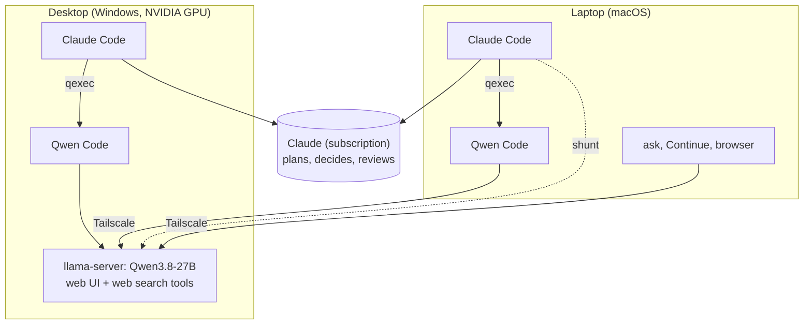

# llm-harness

Claude Code (on a Claude subscription) plans, decides and reviews; a local **Qwen3.8-27B** on your own GPU does the
bulk work: implementing planned changes, writing tests, reading huge files and logs. It works on the desktop that
runs the model and on a laptop over Tailscale, and everything falls back to Claude when the desktop is off.

Claude Code talks to one model provider per session, so the harness does not point Claude Code at the local model.
It keeps Claude Code on the subscription and hands work to a separate executor (Qwen Code) through skills and hooks.

## What you get

- **Delegation in Claude Code.** While the local model is up, a SessionStart hook gives Claude a
  [delegation policy](harness/hooks/delegation-policy.md): implementation goes to Qwen, judgement stays with Claude.
- **`qexec`**: Claude writes a plan with a verify command; Qwen Code implements it in a separate git worktree and
  branch; the verify command runs; Claude reviews the diff and proposes a merge. Falls back to Claude Sonnet.
- **`shunt`**: big reads (files over ~100 KB, many files, long logs, screenshots) go to Qwen, which answers with
  `path:line` citations, so the raw content never fills Claude's context. A Read hook nudges Claude to use it.
- **Status line**: `[Opus …] · repo · ctx 12% · ● Qwen` shows whether the local model is available.
- **`ask`**: one-shot questions to the local model from any terminal, falls back to Claude Haiku.
- **Web chat with web search**: llama-server's built-in web UI plus a small MCP server with `web_search` (DuckDuckGo,
  no key) and `web_fetch` (refuses local and private addresses).
- **Editors**: the Claude Code extension for VS Code and Cursor gets the hooks, skills and delegation (the status line
  is shown by the CLI); Continue gets a direct Qwen chat.
- **Two desktop shortcuts**: start the model for the laptop, or stop it and free the GPU for games.

## How it works



Executors and `shunt` run where the code is (laptop or desktop); only model requests cross the network. The server
listens on 127.0.0.1 and the desktop's Tailscale address, requires an API key, and the firewall allows it on the
Tailscale interface only.

## My setup and numbers

- RTX 5090 (32 GB), Ryzen 7 7800X3D, 64 GB RAM, Windows 11; MacBook Pro as the laptop.
- llama.cpp b12034 (CUDA 13.4), [unsloth/Qwen3.8-27B-GGUF](https://huggingface.co/unsloth/Qwen3.8-27B-GGUF):
  `UD-Q6_K` + `mmproj-F16` (vision, kept on the CPU) + the `MTP` draft for speculative decoding.
- 128K context shared by 2 slots, q8_0 KV cache: about 27 GiB of VRAM, about 150 tokens/s generation with MTP.
- On a small test task Qwen took 95 s and Claude Sonnet 28 s: the local model saves subscription quota, not time.

With less VRAM, pick a smaller quant or context in [server/server.json](server/server.json).

## Repository layout

| Path | What |
|---|---|
| `server/llmctl.ps1` | start/stop/status of llama-server (desktop shortcuts call `up` and `down`) |
| `server/server.json` | model files, context, slots, KV type, MTP, MCP: edit for your machine |
| `server/install-shortcuts.ps1` | deploys llmctl, config and the MCP server to `C:\llm`, creates the shortcuts |
| `server/mcp/web.mjs` | MCP server for the web chat: `web_search`, `web_fetch` |
| `server/bench.ps1` | decode, prefill, tool-call and vision checks |
| `harness/hooks/` | SessionStart (status + delegation policy), PreToolUse(Read) (big files -> shunt) |
| `harness/qexec/`, `harness/shunt/` | the two delegation tools; `harness/skills/` tells Claude how to use them |
| `harness/lib/backend.mjs` | finds a healthy endpoint, cached for 30 s |
| `client/` | `ask`, the laptop installer for it, the Continue installer |
| `install.mjs` | installs hooks, status line and skills into `~/.claude` (`--uninstall` reverts) |
| `tools/llm-discovery.ps1` | read-only survey of a Windows machine before you start |

Everything is plain Node (20+, no dependencies; 22+ to run the tests) or Windows PowerShell 5.1. `npm test` runs the
test suite.

## Setup

### 1. Model server (Windows desktop)

1. Install [Tailscale](https://tailscale.com) on the desktop and the laptop and sign in to the same tailnet.
2. Download a CUDA build of llama.cpp from its [releases](https://github.com/ggml-org/llama.cpp/releases)
   (`llama-<build>-bin-win-cuda-<ver>-x64.zip` and the matching `cudart-…` zip) and unpack both into
   `C:\llm\bin\current`.
3. Download the model files listed in [server/server.json](server/server.json) into `C:\llm\models` (the MTP draft is
   in the `MTP/` folder of the model repository).
4. Create the API key, readable only by you (PowerShell):
   ```powershell
   New-Item -ItemType Directory -Force C:\llm\secrets | Out-Null
   $b = New-Object byte[] 32; [Security.Cryptography.RandomNumberGenerator]::Create().GetBytes($b)
   [IO.File]::WriteAllText('C:\llm\secrets\api-key.txt', [Convert]::ToBase64String($b).TrimEnd('=').Replace('+','-').Replace('/','_'))
   icacls C:\llm\secrets\api-key.txt /inheritance:r /grant:r "$($env:USERNAME):F"
   ```
5. Allow port 8080 from Tailscale only (PowerShell as administrator):
   ```powershell
   New-NetFirewallRule -DisplayName "llm-server 8080 (Tailscale only)" -Direction Inbound -Action Allow -Protocol TCP -LocalPort 8080 -RemoteAddress 100.64.0.0/10 -InterfaceAlias Tailscale
   ```
   If Windows asks whether to allow `llama-server.exe`, do not press Cancel: that creates block rules
   (`llmctl` warns when it finds them).
6. Deploy and create the shortcuts:
   ```powershell
   powershell -ExecutionPolicy Bypass -File server\install-shortcuts.ps1
   ```
   `-Root D:\llm` installs elsewhere; then change the paths in `server.json` too, and after step 2 the `keyFile` in
   `~/.llm-harness/config.json`.
7. Start the model with the **LLM - start** shortcut (it also brings Tailscale up and checks the firewall); free the
   GPU with **LLM - stop (free GPU)**. From a terminal:
   `powershell -ExecutionPolicy Bypass -File C:\llm\llmctl.ps1 up|down|status|logs`.

### 2. Claude Code on the desktop

Needs Node 22+, git and Claude Code signed in. `install.mjs` edits `~/.claude/settings.json` and saves a timestamped
backup next to it first.

```bash
npm i -g @qwen-code/qwen-code@0.26.4
node install.mjs                       # hooks, status line, skills; config from C:\llm\server.json
node harness/lib/backend.mjs --fresh   # expect: qwen3.8-27b @ http://127.0.0.1:8080: ok
```

Start a new Claude Code session: the status line shows `● Qwen`.

Optional on the desktop: `ask` reads `~/.llm-harness/client.json`
(`{"url": "http://127.0.0.1:8080", "model": "qwen3.8-27b", "keyFile": "C:\\llm\\secrets\\api-key.txt"}`) and runs as
`node client/ask.mjs "question"`; Continue is set up with
`node client/install-continue.mjs --url http://127.0.0.1:8080 --key-file C:\llm\secrets\api-key.txt`.

### 3. Laptop (macOS)

Needs Node 22+, git and Claude Code signed in. Put the API key into the Keychain (paste it when asked):

```bash
security add-generic-password -a "$USER" -s llm-harness -w
```

Then:

```bash
git clone https://github.com/SergeiPleshkov/llm-harness.git ~/Projects/llm-harness
cd ~/Projects/llm-harness
npm i -g @qwen-code/qwen-code@0.26.4
node install.mjs --remote http://<desktop-tailscale-ip>:8080
node harness/lib/backend.mjs --fresh                         # expect: ... : ok
sh client/install-mac.sh http://<desktop-tailscale-ip>:8080  # the ask command
node client/install-continue.mjs                             # optional: Continue chat on Qwen
```

Update later with `git pull`: hooks and skills point into the repo.

## Using it

- **Just work in Claude Code.** With `● Qwen` in the status line Claude follows the delegation policy: it says in one
  line what it hands to Qwen, runs `qexec`, reviews the diff and asks before merging. You can also ask directly
  (`/qexec`, `/shunt`, or "hand the implementation to Qwen"). Edit
  [delegation-policy.md](harness/hooks/delegation-policy.md) to change what gets delegated.
- **Which model answered.** qexec reports `executor: … via qwen-code` or `fallback: <reason>` (Sonnet did it);
  shunt answers end with `[shunt read: qwen3.8-27b, …]`; `ask` prints `[ask: local model unavailable …]` when it
  falls back. Logs are in `~/.llm-harness/logs/` (`delegations.jsonl`, `shunt.jsonl`, `hooks.jsonl`).
- **`ask "question"`**, `cat log | ask "what failed?"`, `ask --image shot.png "what is wrong?"`, `ask --claude …`.
- **Web chat**: open `http://<desktop-tailscale-ip>:8080`, press "Enter API Key" once. The model can search the web
  and read pages; calls are logged to `C:\llm\logs\web-mcp.jsonl`.
- **Editors**: install the Claude Code extension (VS Code or Cursor) and, optionally, Continue. Cursor's own chat
  cannot use the local model: Cursor sends model requests through its servers, which cannot reach Tailscale.

## Configuration

| File | Machine | Purpose |
|---|---|---|
| `C:\llm\server.json` | desktop | llama-server settings (deployed from `server/server.json`) |
| `~/.llm-harness/config.json` | both | endpoint(s) for hooks, qexec and shunt: `url`, `model`, `keyFile` / `keyCommand` / `keyEnv` |
| `~/.llm-harness/client.json` | both | endpoint for `ask` and the Continue installer |
| `harness/hooks/delegation-policy.md` | both | what Claude delegates while the local model is up |
| `~/.continue/config.yaml`, `.env` | both | Continue, written by `client/install-continue.mjs` |

## Security

- No secrets in the repo. The key lives in a file readable only by you (desktop) or in the Keychain (laptop) and
  reaches executors through environment variables, never the command line. Copies you create on purpose: Continue
  keeps it in `~/.continue/.env` (mode 600, or in `config.yaml` with `--inline-key`), and the web UI keeps it in
  the browser where you entered it.
- llama-server binds to 127.0.0.1 and the Tailscale address only, and the firewall rule is limited to the Tailscale
  interface and range. Model and tool calls need the key; `/health` and the web UI page itself are open to anyone on
  your tailnet, so share the tailnet only with devices you trust.
- `web_fetch` refuses localhost, private, link-local and Tailscale addresses, also after redirects and at connect
  time, so the model cannot reach services on your machines through it.
- **The executors are not sandboxed.** Qwen Code runs with `--approval-mode yolo` and the Sonnet fallback may use
  Bash, both as your user: they can run any command and touch files outside the repo. The separate git worktree only
  keeps their changes off your branch until you merge. Delegate only plans you would let a colleague run on your
  machine, and review the diff before merging.

## Things I learned the hard way

- Windows PowerShell 5.1 reads BOM-less scripts in the ANSI code page: keep `.ps1` files with non-ASCII text in
  UTF-8 with BOM.
- Processes started from Claude Code's shell tool on Windows live in a job object and are killed later. Start the
  server with the shortcut (or via `Win32_Process.Create`), not from an agent's shell.
- Pressing Cancel in the Windows "allow access" dialog silently adds inbound block rules.
- With MCP enabled, llama-server b12034 sends a `--cors-origins` list verbatim as one header; the same-origin web UI
  does not need it, so it is not set.
- DuckDuckGo may answer with a bot check after many searches in a row; `web_search` reports it and works again later.

## Credits

The `shunt` idea comes from Spotify's [shunt plugin](https://github.com/spotify/portal-ai-plugins/tree/main/plugins/shunt).
Built on [llama.cpp](https://github.com/ggml-org/llama.cpp), [Qwen Code](https://github.com/QwenLM/qwen-code),
[unsloth GGUFs](https://huggingface.co/unsloth), [Tailscale](https://tailscale.com) and
[Continue](https://github.com/continuedev/continue). Most of the code was written with Claude Code.

## License

[MIT](LICENSE)
